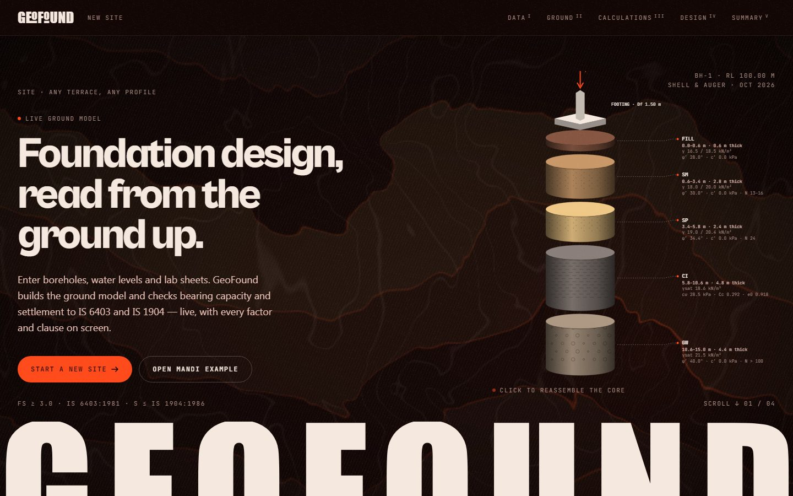
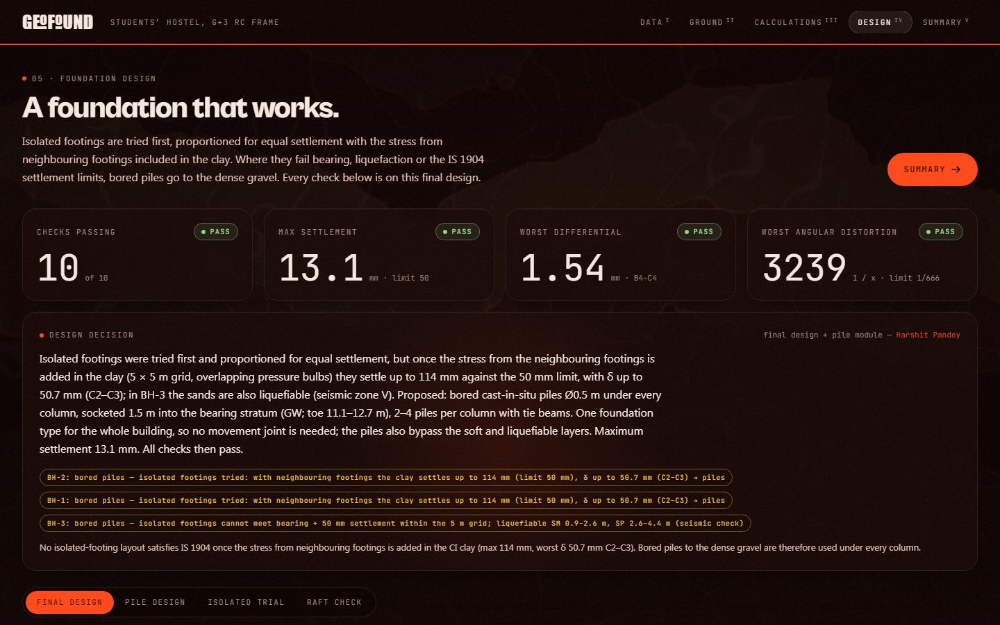
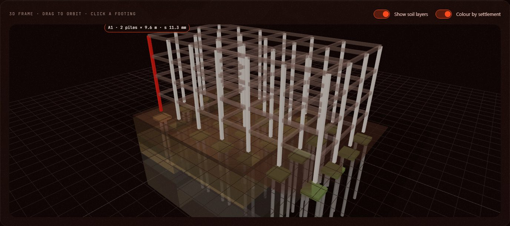
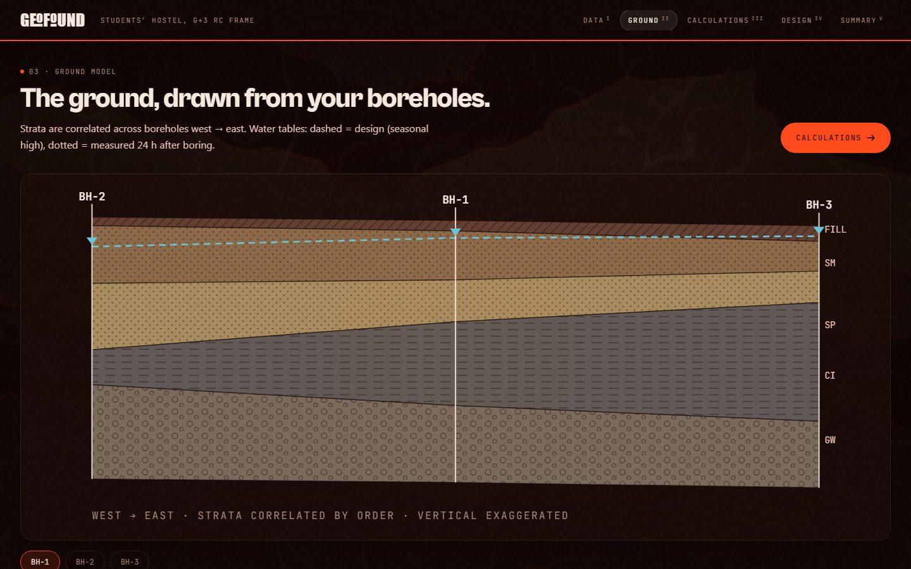
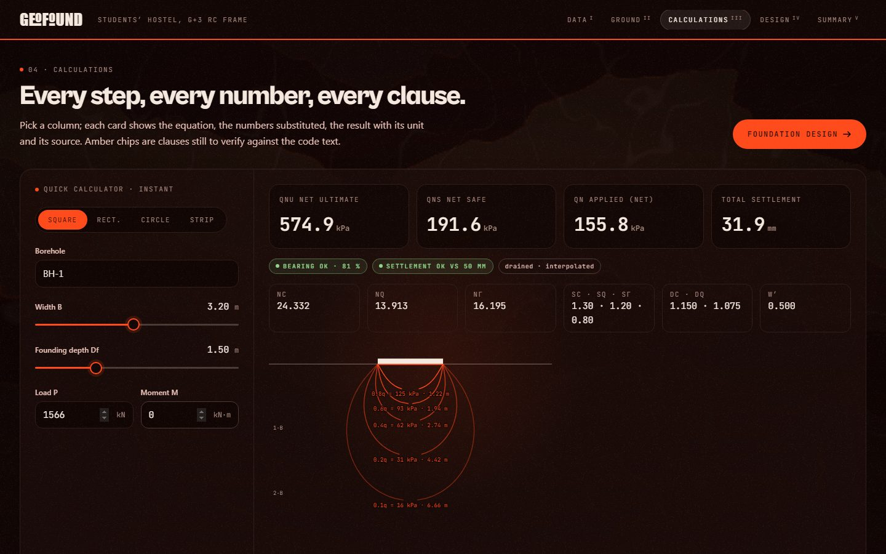
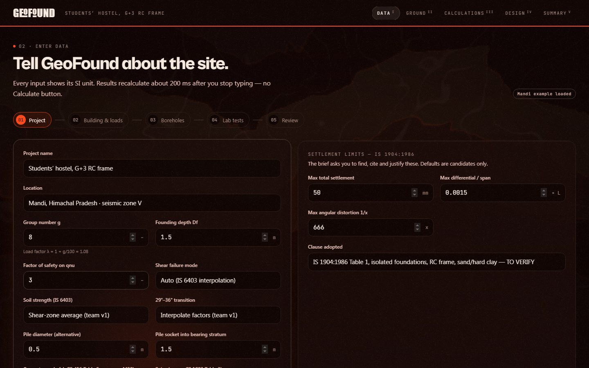
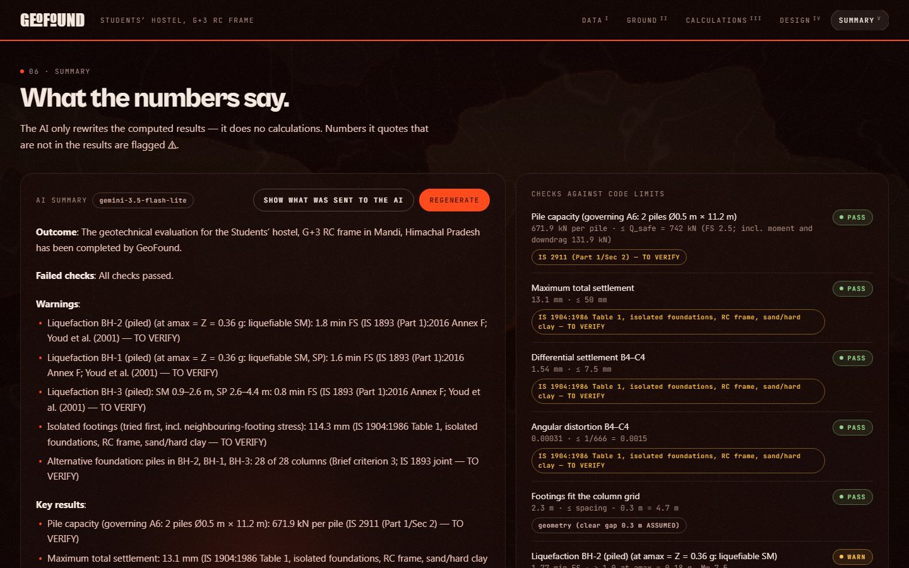

# CE-402 Assignment — Group 8 · GeoFound

[](https://geofound.vercel.app)

<p align="center"><b><a href="https://geofound.vercel.app">Open the live app →</a></b></p>

Foundation design in the browser for the CE 402 (Geotechnical Engineering, IIT Mandi) assignment. Enter a site
(boreholes, lab results, column grid and loads) and GeoFound works through the whole design, showing every equation
with its substituted values and its source:

- **P1** soil profile and stresses for the design and measured water tables
- **P2** IS 2131 SPT corrections; direct-shear least squares (c′, φ′); UU cu; oedometer Cc, Cr, σ′p, OCR, cv
- **P3** IS 6403:1981 bearing capacity (general / local shear, shape, depth, inclination, W′, effective area)
- **P4** stress increase: Boussinesq (centre, corner, superposition) and 2:1
- **P5** Schmertmann (1978) settlement, 1-D consolidation (sublayers ≤ 0.5 m), time–settlement
- **Seismic** liquefaction check from SPT (IS 1893 (Part 1):2016 Annex F), seismic zone II–V as an input
- **Design** isolated footings proportioned for equal settlement, with the stress from neighbouring footings included;
  IS 1904 total / differential / angular checks; IS 2911 bored piles where footings fail
- **Summary** check table, assumptions table, AI-written summary (Gemini free tier), PDF / JSON / CSV export

**Live app:** https://geofound.vercel.app
**v1 platform (earlier version):** https://parashsharma11.github.io/CE-402-Assignment-Group8/ (GitHub Pages, branch `main`)

## Result for the Mandi site
Isolated footings were tried first but, once the pressure bulbs of neighbouring footings are superposed in the CI
clay, they settle up to 114 mm (limit 50 mm); BH-3 also has liquefiable sand. **Recommended: Ø0.5 m bored piles under
every column, socketed into the dense gravel (2–4 piles per column), maximum settlement 13.1 mm — every check passes.**
Full report: [docs/GeoFound_Final_Report.pdf](docs/GeoFound_Final_Report.pdf) · numbers: [docs/DESIGN_SUMMARY.md](docs/DESIGN_SUMMARY.md).





## Screens
| | |
|---|---|
|  |  |
| **Ground** — strata correlated across the boreholes, design and measured water tables, SPT and liquefaction tables | **Calculations** — every equation with substituted numbers and its clause; live pressure bulb |
|  |  |
| **Data** — step-by-step entry (or CSV / JSON import), SI unit beside every input | **Summary** — checks against IS limits, assumptions, AI-written summary with a number check |

## Using the app
1. **Home → "Open Mandi example"**, or go to **Data** and enter your own site:
   project and group number (λ = 1 + g/100), founding depth, seismic zone, boreholes (layers, SPT, water tables),
   lab results, column grid and loads.
2. Boreholes can be **imported from CSV** (Data → "Download template", fill it in, "Import CSV"). The whole project
   can be saved and reopened as JSON.
3. **Ground** — profile, stress plots, SPT corrections, liquefaction table, pressure bulb.
   **Calculations** — every module step by step, plus the team-engine cross-check.
   **Design** — final foundation, pile design, isolated-footing trial, raft check, 3D view.
   **Summary** — checks, assumptions, AI summary, downloads.

## Run locally
Node 20+.
```bash
npm install
npm run dev        # http://localhost:5173
npm test           # 59 tests: hand-calculation benchmarks, v1 cross-checks, full design run
npm run build      # type-check + production build
```
The AI summary needs `GEMINI_API_KEY` (Google AI Studio, free tier) as a Vercel environment variable; without it the
Summary page uses a deterministic template. v1 needs no build: open `platform-v1/index.html`.

## Two versions, one team
| | v1 — GeoTech Analytics | v2 — GeoFound |
|---|---|---|
| Where | `platform-v1/` | repo root |
| Stack | Vanilla JS, Tailwind, Plotly | React + TypeScript (Vite), Vitest, Vercel |
| Engines | P1–P5 by the team | own TypeScript engine **plus the v1 engines, run live as a cross-check** |

`src/team/bridge.ts` loads `platform-v1/js/*_logic.js` unchanged; the Calculations screen shows both results side by
side and `tests/crosscheck.test.ts` checks they agree.

## Repository layout
```text
src/
  engine/          calculation engine — pure TypeScript, a // SOURCE: comment on every equation
    stress, spt, labTests, bearing, stressIncrease, settlement   P1–P5
    liquefaction   IS 1893 Annex F         design     footing checks, IS 1904
    piles          IS 2911 bored piles     finalDesign whole-building decision
  examples/mandi.ts  the Mandi site data — the only place site values live
  team/            bridge to the v1 engines
  lib/             results pipeline, CSV import/export, AI-summary prompt
  store/, hooks/   project state (saved in the browser)
  pages/, components/   screens and UI
api/summary.ts     AI summary server function (key stays on the server)
tests/             Vitest + hand_calcs.md (every benchmark worked by hand)
platform-v1/       the team's v1 platform, unchanged, with its history
docs/
  GeoFound_Final_Report.pdf  final report (research format)
  report/            report source: build_report.py (figures + HTML from data.json)
  DESIGN_SUMMARY.md  results for the report
  AI_AUDIT.md        errors in AI output that we caught and fixed
  AI_Log.pdf, AI_Audit.pdf   final AI log and engineering audit (PDF for submission)
  team/              one task file per member
AI_LOG.md          AI use log, per session
REFERENCES.md      every code, paper and book cited in the engine
CLAUDE.md          project rules for the AI assistant
scripts/           Playwright screenshot / walkthrough scripts
```

## Engineering conventions
SI units throughout (kN, kPa, m, mm, kN/m³), γw = 9.81 kN/m³. Nothing site-specific outside `src/examples/`.
Every clause not yet checked against the code text is marked **TO VERIFY** (amber chip in the app); every value not in
the brief is marked **ASSUMED** with its reason.

## Team (Group 8)
| Member | Contribution |
|---|---|
| **Harshit Pandey** | GeoFound (v2) UI/UX and front-end; foundation design — final design and IS 1904 checks (`finalDesign.ts`, `design.ts`), IS 2911 piles (`piles.ts`), liquefaction (`liquefaction.ts`), oedometer and UU interpretation (`labTests.ts`); integration of the team engines; deployment |
| **Parash Sharma** | P1 soil profile and P2 SPT / direct-shear engines; v1 platform architecture |
| **Gaurav Dtyal** | P3 IS 6403 bearing-capacity engine |
| **Muvan** | P5 settlement engine (IS 8009, Schmertmann, consolidation) |
| **Namit Mehta** | P4 stress-increase (Boussinesq / 2:1) module |

Each member's verification task is in [docs/team/](docs/team/README.md).
